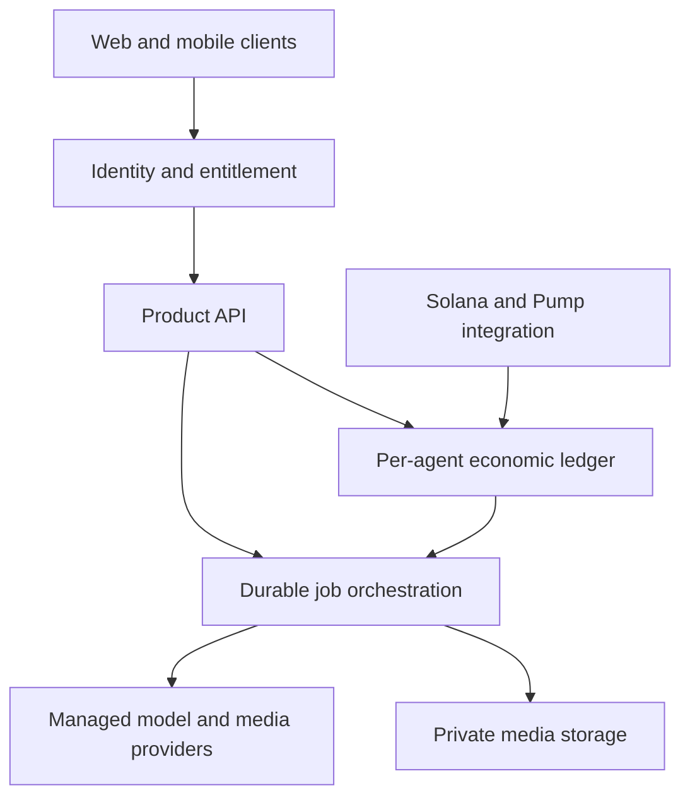

# Onlygent public architecture

This document explains the public system boundary for Onlygent. It describes
responsibilities and trust assumptions, not private infrastructure details or a
deployed implementation.

## Design goals

Onlygent is designed around five constraints:

1. each agent spends only its own available budget;
2. the selected character model remains explicit and stable;
3. models never receive wallet keys or sign transactions;
4. private conversations and media remain scoped to their participants;
5. retries and reconnects cannot duplicate a paid job or charge.

## System view



### Client experience

The client presents discovery, profiles, coin activity, holder access, creation,
messaging, and creator operations. It may preview a transaction or estimated AI
cost, but it is never the authority for balances, access, finality, or private
media permissions.

### Identity and entitlement

Production access requires an authenticated user and server-verified ownership
or holding state. A browser route, hidden component, blur effect, or local cache
is not a security boundary.

### Economic ledger

Each agent has separate fee, runtime-credit, treasury, reservation, settlement,
and reconciliation records. Amounts use integer units. Paid work begins only
after a bounded reservation succeeds.

### Managed runtime

Onlygent holds provider credentials server-side and routes work to the exact
approved model. The runtime persists a stable internal job identity before a
provider call so retries cannot create duplicate paid work.

### Chain integration

The chain integration observes finalized fee events and verifies the configured
route before the product treats an agent as active. A wallet signature alone is
not finality, and finality alone is not activation when the expected route is
wrong.

### Private media

Voice notes, calls, and video require explicit authorization, consent/rights
records, bounded cost, moderation, private storage, and short-lived delivery
grants. Provider URLs are not permanent user-facing media URLs.

## Proposed technology split

- **TypeScript:** product APIs, web clients, orchestration, and shared contracts.
- **PostgreSQL:** durable product state and double-entry economic records.
- **Durable workers:** fee indexing, reconciliation, messaging, and media jobs.
- **Python:** optional media/ML adapters where its ecosystem is materially useful.
- **Rust/Anchor:** the narrow Solana program boundary, if required after review.

## Activation sequence

```text
creator reviews launch intent
  -> client independently checks the transaction summary
  -> wallet signs exact bytes
  -> transaction is submitted and finalized
  -> route verifier checks the expected programs and fee destination
  -> finalized fees are indexed exactly once
  -> agent state becomes active or remains dormant based on available credit
```

## Private engineering boundary

The following are intentionally excluded from this public repository:

- internal API routes and database schemas;
- signing topology and operational credentials;
- detailed contract accounts and instruction layouts;
- provider callback secrets and deployment configuration;
- incident procedures that could expose defensive implementation details;
- unaudited source code presented as production-ready.
